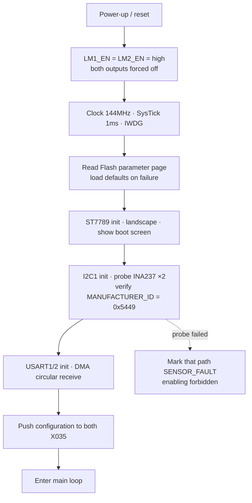
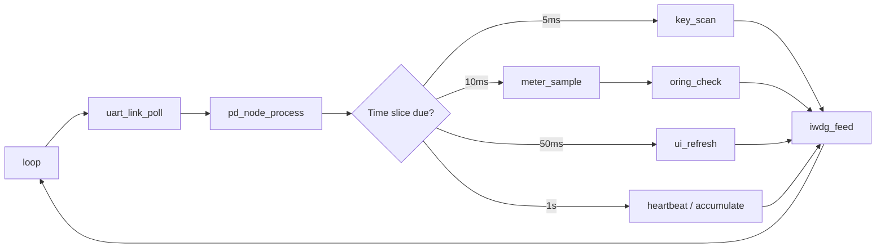
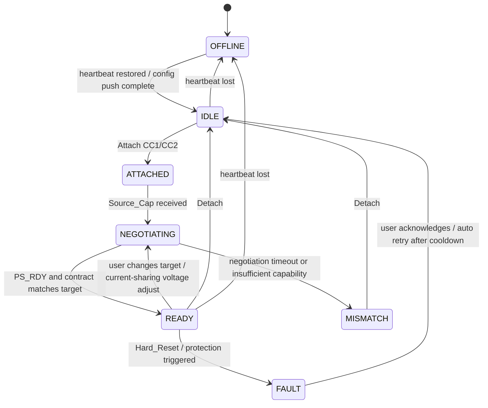
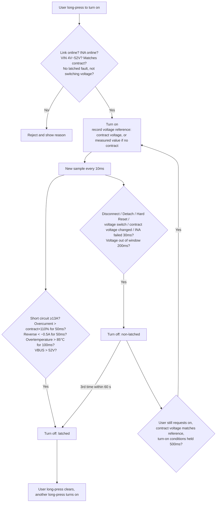

# Main Controller Firmware Global Flow (CH32V203C8T6)

> Board: 48V10+10A ORing | Main controller: CH32V203C8T6 | PD nodes: 2 × CH32X035F8U6 (USB_PD_Trigger `CH32X035_APP_NANO`)
> Display: ST7789 240×320, **landscape 320×240** | Input: TTP223 single touch key | Sensing: 2 × INA237

---

## 0. Directory Structure

```
MainCtrl/
├─ docs/
│  └─ FLOW.md            # This file: global flow
└─ src/
   ├─ bsp/               # Clock, SysTick(millis), IWDG, Flash parameter page
   ├─ drivers/           # st7789 / ina237 / uart_link / key
   ├─ pd/                # pd_proto(packet build/parse) / pd_decode(PDO,RDO) / pd_node(state machine)
   ├─ power/             # meter(metering) / oring(switching and protection) / share(current sharing, phase 2)
   └─ ui/
      ├─ fonts/          # 1bpp glyph bitmaps
      └─ pages/          # Main dashboard / channel details / settings / statistics
```

---

## 1. Hardware Resource Map

| Function | Pin | Peripheral / Notes |
|---|---|---|
| LCD_CS / SCK / DC / MOSI / RST | PA4 / PA5 / PA6 / PA7 / PA1 | SPI1 + DMA1_Ch3 (TX) |
| LCD_BLK | — | Tied directly to 3V3, not controllable |
| INA237 SCL / SDA | PB6 / PB7 | I2C1 polling; CH1 = 0x40, CH2 = 0x44; shunt 10mΩ |
| TOUCH | PB10 | TTP223, active high |
| LM1_EN / LM2_EN | PB9 / PB8 | **High = that path off** (gate pulled up, off by default at power-up) |
| X035 #1 (CH1) | PA2 TX / PA3 RX | USART2 + DMA1_Ch6 (RX), 921600 8N1 |
| X035 #2 (CH2) | PA9 TX / PA10 RX | USART1 + DMA1_Ch5 (RX), 921600 8N1 |
| SWD | PA13 / PA14 | Download / debug |
| Clock | — | No crystal, HSI 8MHz → PLL 144MHz |

---

## 2. Power-Up Boot Flow



**Configuration pushed to the X035, in order** (sent to each path, Mini format only `52 FF len 01 cat cmd value`):

1. `SYS 0x42` switch the report format to Mini
2. `SYS 0x31/0x32` switch SPR/EPR mode according to settings
3. `SYS 0x65` preset voltage (mV), `SYS 0x66` preset current (mA)
4. `SYS 0x64` enable Trigger Hold Preset
5. `SYS 0x02 value=1` read the firmware version (also verifies the link)

---

## 3. Main Loop Scheduling (cooperative, based on 1ms tick)

| Period | Task | Notes |
|---|---|---|
| Every pass | `uart_link_poll()` | Take bytes from the DMA ring buffer → assemble packets → dispatch to pd_node |
| Every pass | `pd_node_process()` | Advance both state machines, resend commands on timeout |
| 5 ms | `key_scan()` | Debounce, detect short press / long press / double tap / triple tap |
| 10 ms | `meter_sample()` → `oring_check()` | Read INA237 V/I/T, **protection check immediately follows sampling** |
| 50 ms | `ui_refresh()` | Redraw only changed regions |
| 1 s | `pd_heartbeat()` · `meter_accumulate()` | GET_STATUS heartbeat; Wh/Ah accumulation |
| End of each pass | `iwdg_feed()` | Watchdog about 500ms |



---

## 4. UART Link (main controller ⇄ X035)

**Receive**: on an IDLE interrupt or a DMA half/full transfer, move the data into the ring buffer. `uart_link_poll` assembles packets by the following rules:

- Header `A2 FF` (Mini) → total length = 4 + `buf[2]`
- Header `A1 FF` (Std) → total length = 12 + `buf[10]`
- Bad header, length over 64, or not fully received within 5ms → discard and resynchronize

**Dispatch** (classified by data type):

| type | Content | Main controller handling |
|---|---|---|
| 0x00 USB PD | `[SOP][PD Header 2B][DO…]` | pd_decode: Source_Cap / EPR_Source_Cap / Request / Accept / PS_RDY / Hard_Reset |
| 0x01 System | Attach/Detach CC1/CC2, VBUS On/Off, CRC Error | Drive pd_node state transitions |
| 0x02 Message | Command acknowledgments, GET_STATUS results | Confirm the command was delivered, update the heartbeat timestamp |

**Send**: one command queue per path; only one command may be in flight at a time.
- If no acknowledgment arrives within 100ms, resend, at most 3 retries; if it still fails, declare LINK_FAULT.
- Heartbeat: send `GET_STATUS(0)` every 1s; no reply for 3s in a row → declare OFFLINE.

---

## 5. PD Node State Machine (one per path)



Data stored per node:
- PDO list (SPR up to 7, EPR up to 11)
- Current RDO
- Contract voltage and current
- EPR flag
- Last communication time

---

## 6. ORing Switching and Protection Flow (every 10ms, each path judged independently)

Implemented in `power/oring.c`; parameters are the `PROT_*` macros in `config.h`. Voltage and current both use INA238 measurements (input side, measurable even when the MOS is off).



**Voltage window**: upper limit = reference × 105% + 250mV, lower limit = reference × 90% − 250mV (extra lower margin left for cable loss). The "matches contract" check at turn-on uses the same window.

**Overcurrent threshold**: contract current × 110%, capped at 11A; with no contract (non-PD source, or the contract message was missed) the Type-C default 3A × 110% is used.

**Response time**: one INA238 conversion takes about 10.6ms; adding the 10ms polling, a short circuit is shut off within about 20ms. The LTC4359 itself has no current limiting, so an instantaneous short still relies on the source-side protection.

**Fault recovery**:
- Latched (overcurrent, short circuit, reverse, overtemperature, absolute overvoltage, and the 3rd non-latched shutdown within 60 seconds): the user long-presses on the MOS page to clear, then long-presses again to turn on.
- Non-latched (voltage window, disconnect, Detach, Hard Reset, contract change, INA failure): if the user has not turned it off, it turns back on automatically once the contract voltage returns to the original reference and the conditions hold for 500ms; a path without a contract does not auto-recover.
- A user turn-off, double-tap all-off, or voltage switch cancels auto-recovery.

**UI**: title bar `ON` / `OFF` / `ARM` (waiting for auto-recovery) / `FLT` (latched) / `LCK` (hardware not identified). The MOS page shows each path's voltage, current and overcurrent threshold (with `?` appended when there is no contract), and the shutdown reason when off.

**Degraded mode**: with `PROT_REQUIRE_ISENSE = 0`, a path can be turned on manually even with the INA offline (for the first board revision); in this case only event interlocks apply, with no measurement-based protection.

**Current sharing** (`power/share.c`, parameters are the `SHARE_*` macros in `config.h`):
- Prerequisites: both X035 run the local-branch firmware (1.2.90+, confirmed that 0xA1 disables runtime NV writes), both paths have contracts at the same voltage, both INA are online, the source has a PPS/AVS PDO at that voltage, and the present current does not exceed the PPS PDO limit.
- Enable (long-press `BALANCE` on the voltage page): the two paths in turn use PD command 0x0D to switch to PPS/AVS at the present contract voltage; the next path is switched only after the X035 contract report confirms the previous one.
- Running: every 500ms compare the two path currents (INA smoothed values). When total current ≥ 0.5A and the difference > 10% of total current, lower the higher-current path by 20mV, or raise the lower-current path by 20mV (choosing the action that brings the sum of both offsets closer to 0). The offset is limited to ±1V and must not exceed the protection voltage window (100mV margin). Absolute voltages are sent, so a missed command does not accumulate error.
- Per-path offset range: the intersection of ±1V, the protection voltage window, and the voltage range of that path's present PPS/AVS PDO (e.g. for a charger whose PPS maximum is 20.00V, at a 20.00V center it can only be adjusted downward). When a command is rejected by the X035 (NO_MATCH etc.), revert to the previous offset and narrow that direction to the previous value; a response timeout also reverts.
- The offset follows the actual voltage in the X035 contract report (synced every comparison period), so the offset shown on screen matches the source.
- Failure counts are kept per path and cleared only by a successful adjustment of that path; 3 consecutive failures on either path exits current sharing.
- Closed loop (since v0.0.51): online estimate of gain k (how many mA the error current changes per 1V of offset change; initial value 5A/V, range 1~40A/V; since v0.0.68 the first measurement directly replaces the initial value, after which each step averages old and new, and an estimate is not used when the load changes by more than 20%; since v0.0.71 it is used only if both paths carry ≥ 15% of total current both before and after the adjustment (`SHARE_K_EST_MIN_PCT`) — when one path carries almost no current its ideal diode is still off, and the measurement reads about 1A/V (actually about 14A/V), which would make the next step overshoot).
  - Step size = |error| ÷ k × gain (NORMAL/FOLLOW 50%, cap 100mV; FAST 80%, cap 200mV), then aligned per path to 20mV (PPS) or 100mV (AVS).
  - Prediction (hysteresis added since v0.0.67): adjust only if the predicted |error| after the adjustment shrinks below 60% of the original, i.e. k × Δv ≤ 160% × |error| (`SHARE_PREDICT_PCT`); otherwise hold. The old rule (k × Δv ≤ 2|error|) judged every step as allowed when the error was about half of one step's effect, and with the EPR AVS 100mV step it oscillated between two steps every 0.5 seconds (measured k = 15A/V, the two path currents swinging between 1.2A/2.7A). This eliminates the back-and-forth oscillation caused by "quantization step larger than the deadband" (e.g. EPR AVS 100mV with very small path resistance). This limit does not apply when current is near 97% of the contract limit.
  - After a new contract is confirmed, wait another 300ms (1.5s for AVS PDOs, since v0.0.70; measured: EPR AVS takes about 1.5 seconds to stabilize after a voltage change) before using current for the next decision (the current average has about 80ms of low-pass delay).
- Dropout hold (HOLD): when a path drops out while running (unplugged, contract invalidated by Hard Reset, UART link broken, or MOS path shut off by protection; a manual user turn-off does not count), current sharing is not exited; offsets are frozen and no longer adjusted. Both paths may drop out one after another and recover one by one; running resumes only when all are back. The other path keeps its present PPS voltage, and the center voltage, both offsets and the PDO selection record are retained. Once the dropped path obtains a contract again and its MOS path is reopened, wait 300ms, then directly send the recorded voltage (PPS: center + offset; fixed PDO: center voltage) and return to running, without the 2s wait of automatic entry and without re-converging from offset 0. After the re-handshake the PDO is reselected from the new capability table (the charger may have been swapped), with offsets limited to the new range. If not all paths recover within 30s, or a recovery command is rejected / times out, exit by the original flow. The screen status shows HOLD and "CHx LOST, HOLDING".
- Manual output off (since v0.0.72): the automatic-entry prerequisite requires both MOS paths to be open; otherwise the wait reason shows "PATH OFF". When the user manually turns off either path while running, HOLD is not entered; instead adjustment is paused and offsets are frozen (k not learned, transient reference cleared), resuming after the path is turned back on; this avoids pushing the offset to its limit while one path is at 0A. Since v0.0.75, after turning back on, wait `SHARE_SETTLE_MS` (300ms) before deciding: measured, deciding 7ms after turn-on saw the CH1 current average still at 0, made one extra step and then reverted it.
- OCP threshold: long-press OCP LIMIT on the SETUP page to cycle 110% (default) / 120% / 130% / 140%, as a percentage of contract current (5.5~7A for a 5A contract), still capped at 11A; saved in settings (sharing the upper 4 bits of the originally reserved byte with the current-sharing mode). When raised, the V203 protection acts later and the charger's own protection may trip first.
- OCP "shift first, then shut off" during current sharing: while current sharing is running with both paths on, and the combined current of both paths does not exceed the sum of their OCP thresholds (merely an uneven split, not a real overload), a path exceeding its OCP threshold first notifies current sharing to perform an emergency shift: without waiting for the period or settle time, it sets in one go the voltage needed to bring that path's current down to 90% of the threshold (computed from the estimated gain k, single step capped at 300mV). At the same time the OCP delay is relaxed from 50ms to 500ms; the path is shut off only if still overcurrent after that. SCP and a real combined overload still use 50ms. Since v0.0.66 the relaxation applies only when both contracts are adjustable PDOs (PPS/AVS): a fixed-PDO charger usually protects itself quickly on overcurrent (output collapses to the 30V level), so relaxing would only let it fall over first.
- Near full load (v0.0.80): when both paths are close to contract current and at either step one path exceeds 97%, if this step is the reverse of the last over-limit adjustment and the "maximum excess" of the step being returned to is not smaller than now, hold (remembered for 10s; keeps holding while the condition persists; cleared on a load transient). Does not depend on gain k. Measured at 9.06A, the old version jumped every 1.5s between 4.87/4.19A and 3.80/5.27A, with CH2 repeatedly exceeding its 5A rating. OCP assist may skip the settle wait only if at least 400ms have passed since the last command (`SHARE_URGENT_GAP_MS`). During OCP assist, if the average current (about 80ms low-pass) shows that the higher path is not the one exceeding OCP (the load just stepped and the average has not caught up), do nothing yet and wait for the average to catch up (v0.0.93; measured on 1→7A it once followed the average and raised CH2 one step in the wrong direction, and CH2 surged to 5.76A). v0.0.93 still could not prevent it (CH2 was still raised one step every time 7A started ramping), so v0.0.94 added: in MANUAL, OCP assist also does nothing within 150ms after a load transient (`SHARE_FF_URGENT_HOLD_MS`); the current-sharing history action gains 0x10 (closed-loop command) and 0x20 (during OCP assist) to tell which code path issued it. Measurement confirmed it was OCP assist at the instant of the load step (history shows TRANSIENT URGENT); under v0.0.94 an 11-minute 1↔7A soak had no reverse adjustment, CH2 peaked at 4.83A throughout, and one PD2 Soft_Reset during that time (no Accept received) caused no trip either. When the combined current of the conducting paths exceeds 97% of the combined contract current, the home page shows a red OVERLOAD at the DIFF position (`oring_overload()`).
- Center voltage alignment (v0.0.90): on entering current sharing, the center voltage is the average of both contracts, aligned to 100mV (the effective AVS step) if either path is in EPR or AVS, and to 20mV only if both are PPS. Up to v0.0.89 it was always 20mV: 48.0V/47.9V averaged to 47.96V, AVS could only give 48.0V, the offset was permanently +40mV, and idle zeroing resent the request every 1.5s, never finishing.
- Center voltage upward headroom (v0.0.97): when both paths are on adjustable PDOs and the center sits at the adjustable PDO's upper limit (e.g. EPR AVS 48V), the center is moved down to the limit − 500mV (`SHARE_CENTER_HEADROOM_MV`), so both paths' offset range becomes −1000..+500 and both can adjust in either direction; on exit it returns to the contract voltage at entry (`v_exit`, e.g. 48V fixed PDO), not the lowered center. Cost: output is 0.5V lower during current sharing. Purpose: previously, with the center at 48.0V, it could only adjust downward, moving only one path at a time; now feed-forward can move both paths in opposite directions by half each, achieving twice the correction per contract round.
- Idle offset zeroing (v0.0.81): after total current stays below 500mA for 10s (`SHARE_IDLE_ZERO_MS`), the offsets are sent back to the center voltage path by path (except a fixed-PDO anchor path), one path at a time, waiting for each new contract to be confirmed. The offset was learned under the previous load and is often the opposite of what the next load needs; measured: after 6A, CH1 stayed at −400mV, then on 0→7A CH2 carried 4.8A right from the start.
  - Zeroing only makes the offsets symmetric; it **cannot make both paths conduct at no load**: at no load there is only the bleeder resistor current (about 48mA with 1k), which flows only through the path with the higher VIN, while the other path's LTC4359 pulls its gate all the way down; the AVS 100mV step is much larger than the LTC4359's 30mV regulation window, so the firmware cannot align both paths to conduct simultaneously. A cold-start step is carried entirely by the awake path during the first 1.5s, and only then shifted by current sharing (measured 0→5A: 4.66/0.42A after 1.5s, 3.24/1.21A after 3.5s).
  - 2026-10-21 measurement (1k bleeder, offsets 0/0, UTL8513 LIST mode; set to 0.01A/µs, but the actual current waveform first jumps to about 1.5A within 0.5ms, then ramps at about 0.085A/ms, reaching 5A only after about 42ms, see `docs/step_0to5A_list.png`): 0→5A passed, VOUT dipped 0.86V, time with dip above 0.5V 0.79ms, CH1 carried 5.06~5.08A; 0→7A failed: CH1 peaked at 6.78A and hit VIN LOST first, CH2 carried 7A alone and then dropped out, and the CH1 charger locked up (cc=0); software REPLUG could not recover it and a physical replug was required. 0→7A had passed earlier with offset −400 only because the then-awake CH2 charger was more tolerant, not because of design margin. **The cold-start step spec is set to ≤ one charger's rating (5A)**; 6A is within the charger's tolerance.
- Load transient freeze: if total current changes by more than 30% within one decision period (sudden load / unload, a charger losing output), no adjustment is made this time and gain k is not updated (history action recorded as 4).
- MANUAL feed-forward and learning (v0.0.86, replaces the former FAST mode, reusing setting value 1):
  - Reason: the two chargers have different load regulation; the closed loop can only take one 100mV (AVS) step every 1.5s, so it takes several seconds to converge after a load change.
  - Learning (`v203ctl learn start` → step the external load through several levels → `learn save`): the closed loop runs as usual while current sharing is running; when the split is already within the deadband (or should not move further after quantization), more than 3s have passed since both the last voltage adjustment and the last load transient, and both paths carry ≥ 15%, every 500ms record the offset difference (CH1 − CH2) in 0.5A bins of total current, with the residual error converted into a correction via gain k (within ±100mV). On save, a 32-bit integer least-squares fit Δoff = a + k × I_total (at least 4 samples per bin, at least 3 bins, current range ≥ 2A) is stored in settings together with both paths' capability-table fingerprints (FNV-1a) and the center voltage. `learn status` shows the per-bin data and the fit result.
  - MANUAL: split in proportion to contract current (same as FOLLOW). When the learned result matches both paths' capability-table fingerprints and the center voltage differs by ≤ 0.5V, every 500ms compute the required offset difference from the filtered total current; if after quantization the difference is ≥ 70% of a step, move only one path, in one step straight to target (also done during load transients); when already at target, the intercept is trimmed by one step (cumulative ±0.5V) only if the error stays outside the deadband for 3s and one step would reduce the error. When the conditions are not met it behaves like the normal closed loop and the home page shows `BAL MAN-NO`; during learning it shows `BAL LEARN`. OCP assist still uses the closed loop.
  - Light-load pre-bias (v0.0.91): when total current is below 90% of the smaller of the two contract currents, the offset difference is set according to that current (e.g. 5A×90% = 4.5A) rather than the actual current, and the intercept is not trimmed. At light load either path alone can carry the load, so there is no need to balance (measured: at 1A nearly all of it was supplied by CH1); on a sudden load step it is only about one step off. Measured 1→7A: with v0.0.90, CH2 first surged to 5.6A (above OCP 5.5A) and it took two or three contract rounds, so the 500ms OCP grace expired and it latched; with v0.0.91, CH2 peaked at about 4.5A and converged in one contract round.
  - Pre-bias revision (v0.0.95): the threshold was changed to 75% of the combined contract current of both paths (7.5A), and, using an estimated gain of 12A/V, the path biased toward is limited to no more than 90% of its contract. In the first 14 cycles of 1↔9A, CH2 peaked at about 5.4A; but both 1↔9A and 1↔8A collapsed after about 10–15 cycles. Scope measurement: the load's LIST occasionally pauses for 20ms and then hard-steps 0→8A within 2ms; pre-bias had CH2 fully off (LTC4359 gate already pulled to 0, about 5ms to turn back on), so the 8A was carried entirely by CH1; the CH1 charger output collapsed to 30V and it protected, then CH2 alone carried 7.9A and also protected.
  - Minimum conduction (v0.0.96, removed in v0.0.102, see below): the pre-bias allowance `pre_mv` is adjusted from 0 by measurement: when the load is stable and already at target, if the path not biased toward carries < 20% (`SHARE_FF_PRE_MIN_PCT`), shrink by one step and do not increase it again within 60s; increase by one step only when it carries > 40% (not exceeding the estimated cap above). Additionally, OCP assist first tries a one-shot feed-forward step (based on the present total current, may span multiple steps, and the direction must reduce the over-limit path), falling back to the closed loop only if that is not possible.
  - Simultaneous adjustment of both paths (v0.0.97): feed-forward (including OCP assist's feed-forward step) splits the required change in offset difference into two halves, lowering the stiffer path and raising the softer path, with both X035 negotiating at the same time; when the step count is odd, the extra step goes to the path that brings the sum of both offsets closer to 0, and when one path hits its limit, the remainder goes to the other. Waiting for new contracts is now per path (`adj_mask`, `adj_prev2[]`, `adj_seq[]`); a rejection/timeout reverts only that path. The normal closed loop and idle zeroing still move one path at a time. Current-sharing history action 5 = both paths simultaneously.
  - OCP assist uses instantaneous current (v0.0.97): the over-limit itself is judged from INA instantaneous values, so assist now uses the instantaneous i1/i2 to compute direction and correction instead of waiting for the average (low-pass about 80ms) to catch up, and the 150ms wait of v0.0.94 (`SHARE_FF_URGENT_HOLD_MS`) is removed. Detection-to-command is about 0.2s earlier. Measured (charger A + good cable / B + high-resistance cable, starting from 1A, 10 runs each of hard step 10A/ms and slow ramp 0.1A/ms): v0.0.96 safe step about 5A (6A slow ramp collapsed on the first try); v0.0.97 passed 5A and 6A for both hard step and slow ramp, each time corrected by both paths simultaneously in one step; at 7A hard step both chargers fell over around the 6th run.
  - Instantaneous tracking (v0.0.98, diagnostic): within 1.5s after a load transient, record both paths' instantaneous currents every 20ms into the current-sharing history (action 6). 1→6A hard step measurement: CH1 instantaneous stuck at 5.37A; detection had to wait for the 500ms period gate + 150ms recheck (up to 0.65s); the contract arrived 30ms after the PD request was sent; **the chargers finished redistributing the current in ~100ms** (starting to move at +180ms, stable at 2.5/3.6A at +260ms), yet the firmware then still waited 1.5s for "AVS settle". The step of Δ from −300 to −400mV dropped CH1 from 5.37A to 2.5A (about 29A/V); the AVS 100mV step itself is very coarse.
  - Fast transient (v0.0.99): every 10ms compare the instantaneous total current with the average; a difference > 30% (and > 200mA) means the load is changing; when the instantaneous total current differs by ≤ 10% on two consecutive samples (20ms) it is considered settled, and feed-forward is applied immediately from the instantaneous value, without waiting for the 500ms period, for the average to catch up, or for the 150ms recheck (history action 4 | 0x40 FAST). `SHARE_SETTLE_AVS_MS` 1500→600, `SHARE_URGENT_GAP_MS` 400→200. During OCP assist, if the learned line says it is already at target (or says the opposite direction) but that path is actually over limit, first take one step in the relieving direction (the split right after a step is worse than the static line; measured 1→7A with pre-bias already in place was still 5.7/1.3A).
  - Fixes (v0.0.99): the center voltage headroom is now judged from the PDO selection result and the capability table (v0.0.97 checked whether the present contract was an adjustable PDO; after a normal exit both paths are on fixed PDOs, so re-entry would not lower it); an INA237 device-level fault (NO_CONVERSION) is now retried slowly every 10s (2026-10-26 measured: lost contact 0.7s after boot following flashing, recovered by a soft reset; previously it was never retried).
  - v0.0.99 measurement: 1→6A and 1→7A hard steps took 0ms from detection to command, both paths back below 5A within 10–40ms; 7A hard step/slow ramp and 8A hard step passed 10 times each (CH1 instantaneous peak up to 6.2A). 8A slow ramp failed on the 3rd try: the load paused briefly at 3.7A during the ramp, fast detection sent one step based on 3.7A, after which CH1 climbed to 6.45A, OCP assist was blocked by the 200ms gap, **charger A protected itself after about 80ms at ≥6.4A** (stricter than the board's OCP 5.5A/500ms), and with all 8A pushed onto CH2 both paths fell over.
  - v0.0.100: OCP assist gap `SHARE_URGENT_GAP_MS` 200→100ms; if that path's instantaneous current has already dropped back below the OCP threshold during the gap, this assist is cancelled (measured: a 0→6A cold step took one extra step at +200ms).
  - v0.0.100 8A slow ramp failed on the 4th try (2026-10-26): in the first 3 runs at 8A the split was 4.4/3.8A, no assist needed. On the 3rd drop to 1A the pre-bias allowance had already been shrunk to 0, and the offsets became 0/0; at 1A one step (100mV ≈ 0.9A) exceeds the load, the split is bistable, and in the end CH1 carried the 1A alone. The next ramp went almost entirely into the stiffer CH1, which climbed to 6.9A within 100ms; assist was sent only at +100ms, by which time charger A had already protected itself. Additionally, at 8A the trim flipped between the −400/−500mV steps every 3s (it used the closed loop's `sh.k`, which MANUAL never estimates and which stays at the initial 5000, while the actual value is about 9000 mA/V), and the +100mV it flipped to was then applied at 1A as well.
  - v0.0.101: the allowance is adjusted only when total current ≥ 2.5A, initial value 300mV; after the fast transient has located once, the instantaneous total current must change by another 30% before the average catches up to count as a new transient (previously, during the average's lag after 8→1A, it located every 10ms). Superseded by v0.0.102 before being measured.
  - **Cleanup (v0.0.102)**:
    - The target is a single function `ff_want()`: offset difference = a + k × I + intercept trim; when total current is below 75% of the combined contract current, the line's value at 75% is used (pre-bias fixed, with the favored path not exceeding 90% of its contract). Removed the measured shrink/grow of `pre_mv` and minimum conduction (at light load one step already exceeds the load, so it cannot work; shrinking only switches which path is off). Any point along a ramp yields the same target, so the false-plateau step no longer occupies the assist gap.
    - Only two kinds of triggers, both sent via `ff_step()` (`run_ff()`): events (OCP assist, fast transient, using instantaneous current) and periodic (every 500ms using average current; if still changing, check again after 150ms). Only the periodic decision does intercept trim. OCP assist no longer falls back to the closed loop; a single transient records only one history entry (action 4 | URGENT or FAST).
    - Gain unified as `SHARE_GAIN_MA_PER_V` 9000 (1V of offset difference changes one path's current by 9A; 2026-10-26 8A measurement: 100mV ≈ 0.9A): shared by the closed-loop initial value, the pre-bias cap estimate and the trim prediction (previously two values, 5000 and 12000).
    - Intercept trim: only in the high-load region (≥ 75%), and only when the 9000-based prediction says one step would reduce the error; a reverse correction (back to the previous step) is made only when the load change is ≤ 10% and the error is larger than before the last correction, without relying on how accurate the gain estimate is. The correction applies to the whole line, including the light-load pre-bias (that is the position pre-staged for high load).
    - Entry and HOLD recovery share `run_reset()`: it clears OCP assist, the transient reference, the fast transient reference, the trim timer and the settle wait (HOLD recovery previously missed these). Switching modes also clears the trim direction and the transient reference.
    - Risk (to be tested): with pre-bias fixed, at 1A the stiffer CH1 is almost off; on a hard step the LTC4359 takes about 5ms to turn back on, during which CH2 carries the load alone. The v0.0.96 collapse was in the opposite direction (CH2 off, CH1 collapsed); the 8A hard step must be retested.
  - Board variant misdetection fix (v0.0.103): a software reset with less than 5s of runtime does not take the warm-reset path and instead redetects the board variant, but C30 on the EN line still holds it high (τ≈5ms), and previously only about 3ms was sampled, so an LTC4359 board was misdetected as LM74700; "turn on" then actually pulled EN low, keeping both paths off, and the wrong board variant was also stored in the reset record and reused by later warm resets (after flashing v0.0.101/102 the output stayed at 0V). Now it waits about 36ms before detection, and the reset record identifier was changed to invalidate old records. Before testing, use the scratchpad `preflight.py` to confirm the board variant, EN pin level and bleeder current.
  - v0.0.103 measurement (2026-10-26): 1↔8A slow ramp ×10 all passed, both path peaks ≤ 4.95A, VOUT minimum 47.02V; the trim changed from −500 to −400mV on the 1st 8A and then stopped flipping, needing no adjustment at all from the 3rd run onward. **The 8A hard step failed on the very first step (0→8A)**: at idle the offsets were −200/+200, only CH2 was conducting and the CH1 gate was pulled to 0; at the step instant everything was carried by CH2 (charger B + high-resistance cable), its input collapsed to 30V within a few ms, then CH1 carried 8.15A alone for about 100ms and charger A protected itself. The v0.0.99 8A hard step passed because back then the offset difference at 1A was about −100mV and CH1 was still conducting, so the stiffer CH1 took the step first (peak about 6A, falling back after one fast transient step). Conclusion: the more negative the offset difference at light load, the safer the slow ramp and the more dangerous the hard step; with this set of chargers and cables the two conflict.
  - v0.0.104 compromise (pre-bias threshold 75% → 32%, light-load offset difference about −200mV; intercept trim phased in linearly from the threshold, at full weight from 60% of the combined contract and learned only above that). The 8A hard step failed on the first step (0→8A): at the step instant CH2 was 6.46A / CH1 2.82A (CH1 gate still opening); OCP assist judged CH2 over limit and pushed the offset difference one step toward CH1 (the learned line actually wanted to push −340mV toward CH2); once the CH1 gate was fully open, at −100mV it climbed to 6.9A within 70ms, charger A protected itself, and CH2 then carried 8.2A alone and also dropped out. Even without that step, at −200mV the static split at 8A is about 6.4/1.6A, so CH1 would still exceed 6.4A. The load's DYN mode draws no current whenever LOW > HIGH, so it cannot start from 1A; the first hard step is necessarily 0→8A.
  - Reverted to v0.0.103 (2026-10-26, rebuilt image bit-identical to the earlier one): **1↔7A hard step ×10 passed** (the first one 0→7A), no protection events, no PD dropouts, VOUT minimum 47.02V, ending at 3.6/3.5A. Within 10–40ms after the step, CH2 instantaneous was 5.5–6.6A (CH1 gate still opening), after which it naturally rebalanced; in 8 of the runs OCP assist pushed the offset difference one step toward CH1 on the first sample (−400 → −300mV), giving 4.2/2.9A, which was pushed back by the periodic decision 0.6–0.8s later. This step is unnecessary (the natural redistribution completes within 30ms), and it was exactly this step that overloaded CH1 when the 8A compromise failed. Current capability: 8A slow ramp, 7A hard step.
  - Wait for current to settle (v0.0.91): if total current changes by > 10% and > 200mA between two decisions, treat it as still ramping and decide again after 150ms, to avoid locating on a mid-ramp current and wasting a contract round.
  - OCP during brief contract loss (v0.0.92): since X035 2.2.3, when a request does not get an Accept, a Soft_Reset is sent first, and no contract is reported during renegotiation (VBUS unchanged). Within 1.5s after the contract is lost (`PROT_OCP_HELD_MS`), the OCP threshold keeps the pre-loss contract current, to avoid falling to the 3A tier and shutting off a path carrying more than 3.5A.
- Warm-reset gap under load (v0.0.88~89, 2026-10-25, Q3/Q1 already replaced with IPT059N15N3): with v0.0.87, a warm reset under a 1A load dropped VOUT from 47.5 to < 8V, with the path open for about 20ms. Cause: the board variant detection in `oring_init()` floated EN for sampling, so SHDN was held only by C30 (100nF) through R12 (50k); discharging below the threshold turned off the LTC4359, and turning back on required about 3ms of 10µA gate charging. v0.0.88: the reset record also stores the board variant; on a warm reset the floating detection is skipped and EN is driven directly according to the record (gap 7ms, VOUT minimum 31V). v0.0.89: `src/bsp/startup_reset.S` replaces the SDK's weak `handle_reset`, calling `oring_reset_hook()` to restore EN immediately before copying .data / zeroing .bss (gap about 3ms, VOUT minimum 40.5V at 1A); since it no longer references the SDK startup file's local label `_vector_base`, it uses `_einit` instead, and the custom linker script `ld/Link_keepvec.ld` adds `KEEP` to `.vector` (otherwise gc-sections would discard the interrupt vector table). The remaining ~3ms is the time during which SHDN still briefly dips below the threshold at the reset instant and the gate recharges; shortening it further requires larger C30/C18.
- Immediate re-conduction on warm reset (v0.0.83): every time a path is switched, both paths' on-states and voltage references are written to the reset record area (0x200047C0, retained across software/watchdog resets, with a check code). At boot, if the reset cause is watchdog/software/reset pin, the record is valid, and the last run lasted at least 5s (`PROT_WARM_MIN_UPTIME_MS`, to avoid a reset-at-boot loop), the paths that were on before the reset are turned on right after `sys_init`/`delay_init` and before LCD initialization (`oring_warm_start()`). After that, until the PD link's first report (up to 3s, `PROT_WARM_HOLD_MS`), only measurement-type protections run, skipping the link/DETACH/Hard Reset/contract checks; after the first STATUS, the event counts at that time are used as the baseline. Origin: on reset EN is pulled down to off, VOUT discharges through the 1k bleeder, and the old flow reopened only after about 1.4s; the LTC4359 slowly charged the gate at 10µA, the MOS conducted linearly across about 30V to charge the output, and the inrush dropped the charger input to 36V and disconnected it (twice on 2026-10-21). Verification: four `wlink reset` runs all recovered at 0ms with no shutdown or DETACH; but `wlink reset` itself halts the CPU for about 0.4s, during which VOUT falls linearly with the bleeder current (47.6 → 33V within 150ms), whereas a real watchdog reset gap is only a few ms. v0.0.84 added debug command 7 SYSTEM_RESET (arg must be 0x21545352 "RST!", the firmware calls `NVIC_SystemReset()`, `v203ctl.py reset`): measured after a software reset, both paths recovered at 0ms with no events, the scope's 47.4V trigger did not fire, and the VOUT dip was < 0.25V.
- Recovery backoff: after a non-latched shutdown, the 1st / 2nd / 3rd auto-recovery waits at least 1s / 3s / 10s respectively; the 4th within 60s becomes latched (PROT_TRIP_MAX = 4). Shutdowns caused by voltage switching (VSET) are not counted and have no backoff.
- Software replug (v0.0.76, requires X035Pd 2.2.0): `oring_replug()` first shuts off that path with reason "REPLUG" (not counted toward trips) and clears the latch, then sends ERROR_RECOVERY (0x08, 500ms). The X035 drives CC to 3.3V via GPIO (the on-board Rd is an external resistor and cannot be disconnected), the charger sees it as unplugged, cuts VBUS and resets the port, then after recovery renegotiates from 5V and requests the original target. If current sharing is running it enters HOLD and recovers normally when the contract returns. Rejected if the other path's VIN is below `PROT_REPLUG_PARTNER_MV` (4.5V). Measured to still be effective when the charger has locked up and removed Rp (X035 CC detection reads 0) (2026-10-21, a 240W charger recovered in 2.3 seconds).
- Path hardware self-check (v0.0.78):
  - **OFF LEAK** (latched): LTC4359 boards only. While the path is off, the INA still measures more than 150mA (forward or reverse) for 300ms, meaning one of the back-to-back MOS has broken down. Only visible under load. Uses the smaller of the average and instantaneous values (v0.0.94): the average (low-pass about 100ms) takes more than 300ms to fall below the threshold after a shutdown under load; measured: once a false 322mA trip after 5.7A was shut off by OCP (after ALL OFF, VOUT discharged to 0, confirming the MOS was fine).
  - **PATH DROP** (latched): both paths on, total current ≥ 1A, and this path's input is more than 400mV higher than the other's yet it carries less than 10%, for 1s. A normal ideal diode would have conducted long before, meaning this path's MOS is not being driven and current flows through the body diode. The value is the input voltage difference between the two paths.
  - Origin: 2026-10-21 measurement, CH1 behaved the same whether on or off (0.74V drop at 2A, still supplying when OFF), and the VOUT-side MOS was heating, so the VIN-side MOS was judged to have broken down.
- Remote operation (v0.0.79, for testing): debug command mailbox `dbg_cmd` in RAM (`src/app/dbgcmd.c`), written from the PC with `tools/v203ctl.py` via WCH-Link. Commands: switch a path, clear latch, all off, REPLUG, current-sharing mode, switch voltage; they use the same functions as the menu (`oring_request`/`oring_replug`/`share_request`/`app_set_voltage`), with the same protection and rejection conditions. Executed only if the upper 16 bits of `req` are `0xC0DE`, to avoid SWD bit errors triggering actions.
- Protection event log: the last 8 shutdowns (time, path, reason, value, latched or not, count within the window), RAM ring buffer `prot_log` (magic "PEVT"), read via WCH-Link. Since v0.0.82, the HARD RESET value = upper 16 bits 3 (received, initiated by the charger) / 4 (sent, initiated by the X035), lower 16 bits the X035 event parameter (2.2.1+: upper 5 bits = PE state at RX / initiation reason for TX, lower 11 bits = ms spent in that state, see X035Pd `docs/PROTOCOL.md`).
- X035 event log (v0.0.82): every EVENT reported by the X035 (ATTACH/DETACH/HARD_RESET_RX/TX/SOFT_RESET/CONTRACT …) is stored in the RAM ring buffer `pd_evt_log` (magic "PDEV", 16 entries: time, path, code, parameter), read via WCH-Link. Origin: on 2026-10-21, CH2 had a Hard Reset 40ms after current sharing sent +100mV, and the old version could not tell whether the charger or the X035 initiated it.
- Current-sharing history: RAM ring buffer of 128 entries (one per comparison period: time, both path currents, both path offsets, action), about 64 seconds, read via WCH-Link (`share_hist`, magic "HIST").
- Load-transfer overcurrent (OCP XFER): when OCP occurs and the other path is not sharing the load (path off, current < 200mA, or shut off within the last 2s), it is treated as a load transfer caused by the other path dropping out and is not latched; it auto-recovers once the other path turns back on after this path's shutdown, or retries after 5s. It still counts toward 3 within 60s → latch. Ordinary OCP and SCP latch as usual.
- Input loss (VIN LOST): while on, if the measured input stays below 70% of the reference voltage for 25ms (`PROT_VIN_LOST_MS`, since v0.0.85; each INA conversion takes about 10.6ms, so this covers at least two independent conversions), the path is shut off immediately (without waiting the 200ms of the voltage window), non-latched, and turned back on automatically after the input recovers. Up to v0.0.84 a single reading triggered a shutdown: on 2026-10-21 while replugging CH1, CH2 read 20.9V once (PD contract and X035 VBUS both normal) and was falsely shut off for about 1.5s. When the charger is unplugged but the input is back-fed from the output through the MOS, the voltage does not drop; the dropout is only detected when the X035 reports detach or a Hard Reset.
- Adjustable range (since v0.0.67): in EPR mode the per-path upper/lower limits are also computed from the EPR capability table (e.g. no further upward adjustment when the EPR AVS maximum is 48V).
- PDO selection (PPS first): on entering current sharing each path selects a PDO from its capability table in the order PPS → fixed PDO → AVS. If a path has no PPS at the center voltage, it stays on the fixed PDO without adjustment (the home page shows FIXED for that path) and only the other path's PPS is adjusted; AVS is used only when neither path has PPS. When one path stays on a fixed PDO, the center voltage is that fixed PDO's voltage. When the capability table is unknown (the V203 booted later than the X035 and did not see Source_Capabilities), the X035 is left to select an adjustable PDO itself.
- Modes (long-press BALANCE on the voltage page to enter selection, tap to cycle OFF / NORMAL / FAST / FOLLOW, long-press to apply; saved in settings, and switching while running takes effect immediately):
  - NORMAL: equal current on both paths, adjust 20mV every 500ms, deadband 10%.
  - FAST (fast adjustment): compare every 100ms (still waits for the new contract of the previous adjustment), deadband 5%, step = current to shift × 100mV/A, rounded to 20mV, capped at 200mV. Converges quickly, but oscillates more.
  - FOLLOW (follow PDO): the target split is proportional to both paths' contract currents (for PPS/AVS, the requested value, i.e. that PDO's maximum), e.g. at 5A:3A CH1 carries 62.5%, so both paths max out together as the load increases. The downward offset is relaxed to 1.5V (also limited by the protection voltage window's lower limit, with 500mV reserved for cable loss), allowing the overall voltage to drop; the adjustment period is the same as NORMAL, and the deadband is reduced to 4%.
  - All modes: when the path above its target exceeds 97% of its contract current, adjustment continues regardless of the deadband. AVS path voltages are aligned to 100mV (the RDO's low 2 bits must be 0), PPS to 20mV.
- Disable: the two paths in turn use 0x0C to switch back to fixed PDOs.
- Abort: disconnect, unplug, contract no longer an adjustable PDO (e.g. Hard Reset), command rejected or timed out 3 times → if any path is still on PPS, switch it back to a fixed PDO first, then stop and show the reason on the voltage page. When the user switches voltage, stop directly (the subsequent Hard Reset renegotiates).
- Cost: PPS PDO current limits are usually lower (both present chargers offer 3A on PPS vs. 5A on fixed 20V), and during current sharing the overcurrent threshold follows the contract to 3.3A.

---

## 7. UI and Key Flow

**Key events**:

| Event | Browse mode | Edit mode |
|---|---|---|
| Short press | Next page | Current item's value +1 step (wraps around) |
| Long press 1s | Enter edit (settings page only) | Save and exit |
| Double tap | Total output ON/OFF | Move to the next setting item |

**Pages** (since v0.0.63, see docs/UI_FLOW.md for details): the view pages HOME → TREND 5min → TREND 30s → CAPS (charger capability table) → STATISTICS cycle with a single tap; a long press enters MENU (OUTPUT · VOLTAGE · BALANCE · SETUP · BACK); RESET STATS in SETUP clears the statistics of the current session. BACK on menu pages always returns one level up. Double-tap all-off and triple-tap all-on work only on view pages (triple tap only on HOME); multi-tap recognition is disabled on menu pages, and a single tap fires immediately on release. If both paths were already on before the double tap, a triple tap does not turn them on again (avoiding a momentary dropout); latched faults are not cleared automatically, and rejected paths show the reason in a notice. When editing VOLTAGE, only the fixed PDOs present in the charger capability table are listed (with SYNC, those both paths have; if EPR is supported but not yet entered, 28/36/48V are listed additionally).

**Home page** (`ui/pages/page_home.c`, previews `docs/ui_home_*.png`, generated by `tools/home_preview.py`):
- Visuals use the EVA Unit-01 color scheme (since v0.0.56): pure black background, pale violet-white digits, grayish-purple labels, dark purple grid lines; EVA green is used only for the total output block, title markers and the on state; notices use NERV orange, alarms magenta-red, and low current and page entries Unit-01 purple; strict grid; states use geometric shapes: on ●, waiting for recovery ○ (orange), off □, fault ▲ (red), offline □ (red), with the left status bar in the same color.
- The upper and lower bands are CH1 / CH2 power (path names not labeled); the yellow block on the right is the total output power and total current.
- When current sharing is on: each band shows the voltage offset and current share, shaded from white according to the current difference (0% white → solid color at 20% and above, 16 levels), with the higher-current path tinted red and the lower one blue; the two-path share bar at the bottom right uses the same color scale. The right side shows the mode (BALANCE / BAL FAST / BAL FOLLOW) and status, the current difference (DIFF always white; during current sharing it is the deviation from the target split), the center voltage and the adjustment count. In FOLLOW, a 3px tick below the bar marks the target split.
- Interactive FUI: thin-line ticks, unlit segments shown dimmed (`ui/seg.c` geometric seven-segment digits, only changed segments are redrawn), a scan line on page entry, and when on, a light dot flows along the tick line at a speed proportional to power.

**Refresh strategy**:
- No full-screen frame buffer. Each page consists of several "widgets"; each widget remembers its last displayed value and is redrawn only when the value changes.
- Glyphs are expanded to RGB565 into a 3KB double buffer and sent out via SPI DMA.
- If FAULT or MISMATCH occurs, the top status bar flashes red, so it is visible from the other pages as well.

---

## 8. Parameter Storage

Implemented in `app/settings.c` (access) and `app/app.c` (power-up policy), with low-level erase/write in `bsp/flash.c`.

**Location and format**:
- Program space (v0.0.74): `snprintf`/`vsnprintf` switched to a self-written compact implementation `src/bsp/tiny_printf.c` (supports `%d %i %u %x %X %c %s %%`, flags `- 0 + space`, width and `*`, precision, `l h hh z`; no floating point), no longer linking newlib's printf and malloc, saving about 2KB. The four fonts switched to per-glyph zero-run-length compression (`tools/gen_font.py` generates `*_offset[]`, `gfx_draw_char` decodes row by row), 11.5KB → 9.1KB. Total 57076 B → 52784 B.
- The last 4KB of V203 Flash (`0x0800F000`~`0x0800FFFF`, since v0.0.86), rotated using the CH32V203 fast-mode 256-byte page erase (`FLASH_ErasePage_Fast`). `board_upload.maximum_size = 61440` in `platformio.ini` ensures the program never grows into this region. Up to v0.0.85 it was the last 8KB with 4KB sector erase and a 56KB program limit; after the change the program space gained 4KB (v0.0.86 uses 57232 B/60KB).
- Each record is 128 bytes (magic "SET2"): magic + sequence number + content + MANUAL learning result + reserved + CRC32 (the CRC is placed last, so a power loss mid-write invalidates the record). 2 records per page, 32 in total.
- New records are appended sequentially; a page is erased only when writing moves to a new page, and the previous valid record is always in the preceding page, so if power fails during an erase the old record is still there.
- Legacy format migration: when no SET2 is found in the new region, the record with the highest sequence number is taken from the old 8KB region (starting at `0x0800E000`, 64-byte "SET1" records whose first 60 bytes are identical to SET2) and reused, then written to the new region as SET2 after 2 seconds. 2026-10-21 measured: SET1 #652 → SET2 #1, settings and accumulated energy fully retained.
- At boot the valid record with the highest sequence number is used; if there is none, defaults are used.
- This V203's erased value is `0xE339E339`, not `0xFF`, so validity is judged only by magic and CRC.
- During erase/write HCLK is temporarily divided by two; after writing, each word is read back and compared.

**Contents**:

| Item | Default | Notes |
|---|---|---|
| SYNC | ON | The voltage page switches both paths in sync |
| Target voltage CH1 / CH2 | Not set | Recorded when successfully applied on the voltage page |
| Auto output at power-up | OFF | Set on the SETUP page |
| Accumulated Wh, Ah | 0 | Can be cleared on the SETUP page (long press twice) |
| MANUAL learning result | None | Saved by current-sharing learning (`v203ctl learn save`), see §6 |

**Write timing**: written 2 seconds after a setting changes (coalescing consecutive changes); on a voltage switch, **written immediately, before the command is sent** (if that path is the only source, the whole board loses power during the Hard Reset); accumulated energy every 10 minutes, only if it changed. At most 10 minutes of energy accumulation can be lost. Assuming one record every 10 minutes, each page is erased once every 32 records (about 5.3 hours), giving about 6 years of life for a 10k erase-cycle endurance (boot also writes a record, so actually somewhat shorter).

**Power-up policy (main controller is authoritative)**:
- **Switch voltage one path at a time**: 3V3 (the V203 and both X035) is powered only from the two VBUS rails ORed via D3/D4 (SS110) into U5 (LMR51606). A simultaneous Hard Reset on both paths drops both VBUS to zero at the same time for about 1 second, and the whole board loses power. Therefore SYNC switching and power-up pushes are queued path by path: the next path is switched only after the previous one completes and 1 second has elapsed, with the other path maintaining power during that time. With only one source connected, power loss is unavoidable.
- When the X035 link first comes online, if its stored trigger-hold settings (preset voltage, AP mode, maximum current, SPR/EPR) do not match the saved target voltage, they are pushed again (this triggers a Hard Reset, so it is only done while the output is off).
- With auto output at power-up enabled, both paths enter the waiting state (title bar `ARM`) with the target voltage as reference, and turn on automatically once the contract voltage matches and the turn-on conditions have held for 500ms. Sources without a PD contract are not turned on automatically.

**Entering the SETUP page**: long-press on the DIAG page.

**Flashing**: `upload_protocol = wlink`, which erases only the sectors occupied by the program and preserves the parameter area (the original wch-link/OpenOCD erases the whole chip).

**Reset tracking** (`bsp/resetlog.c`): the main loop writes the current stage to `0x200047C0` (not in .bss, not cleared at startup). After a watchdog or software reset, the boot log and the SETUP page show which stage it last stopped at and how long it had been running. Invalid after a power loss.

## 9. Development Milestones

| Phase | Content | Acceptance criteria |
|---|---|---|
| P0 | Project skeleton, clock, SysTick, LM_EN off by default, IWDG | SWD can download and debug |
| P1 | ST7789 driver + gfx + font library | Landscape orientation, colors and refresh speed all correct |
| P2 | INA237 driver | Both IDs readable, V/I calibration done |
| P3 | Flash the NANO firmware to the X035 + uart_link | Attach events and GET_STATUS replies are received |
| P4 | pd_node + pd_decode | Stable negotiation to EPR 48V, PDOs shown on screen |
| P5 | oring switching + protection | Unplug/replug, overcurrent and wrong voltage all shut off correctly |
| P6 | UI pages + keys + parameter storage | The whole unit is usable day to day; settings and accumulated Wh are retained after power loss |
| P7 | AVS current sharing, statistics, submit a PR to the upstream repository for the GET_STATUS(2) contract report | Current difference between the two paths < 10% |

---

## 10. Known Hardware Limitations (for the next board revision)

1. The backlight BLK is tied directly to 3V3, so it can neither be dimmed nor turned off. Suggest connecting it to PB0 (TIM3_CH3).
2. The INA237 ALERT is not connected, so overcurrent protection can rely only on software polling. Suggest connecting it to an EXTI on PB1.
3. The X035 SWD (PC18/PC19) is not broken out, so the first flashing can only go through the Type-C USB ISP.
4. The whole board has only one touch key, so all interaction must be done with a single key.
5. **LTC4359 slow cold start**: IGATE(UP) is only 10µA (6~14µA), and at no load the 30mV forward regulation pulls the gate low; each path has two IPT015N10N5 back-to-back with a total Qg of about 338nC, so the gate takes about 34ms from off to fully on. When load is suddenly applied from no load, VOUT collapses, the MOS endures SOA stress in the linear region, and the inrush current trips the charger's protection. The two MOS failures on 2026-10-21 (CH1 Q3, CH2 VIN side) are judged to be related to this.
   - Added: SMCJ54A TVS + 100V 100µF on each input; a 1kΩ bleeder resistor on VOUT (about 2.3W, about 48mA at no load, keeping one path's gate at the edge of conduction).
   - Scope-measured VOUT dip on a step from no load: without bleeder 0→2A > 22V (> 5ms); 2k 0→2A/0→4A 3.0V (about 2.3~2.5ms); 1k 0→2A/0→4A 1.02V (0.81ms), 0→5A 0.86V (0.79ms), 0→6A 1.95V (0.75ms); 0→7A both chargers dropped out. Note: these were all in UTL8513 LIST mode; the CH4 current monitor shows that only the initial ~1.5A is a fast step and the rest ramps at about 0.085A/ms (the load did not apply the `CURR:SLEW` setting), so the dip figures represent "a fast step of about 1.5A + slow ramp"; a true fast large step would be worse.
   - True fast step (UTL8513 DYN mode HIGH=target, LOW=0, stepping when the input is enabled, rising to the target in about 0.5ms, 1k bleeder, offsets 0/0, 2026-10-21, `docs/step_dyn_fast.png`): 0→2A dip 0.9~0.97V; 0→3.5A 1.58V (above 0.5V for 1.56ms); 0→5A 2.13V (above 0.5V for 4.14ms, CH1 input minimum 45.74V); all three passed with no protection events. At 5A the load was still carried entirely by CH1 (5.08A) for 1.5s, and then shifted by current sharing.
   - MOS replacement without board changes: **IPT059N15N3ATMA1** (TOLL footprint compatible, 150V, RDS(on) 5.1/5.9mΩ, Qg 69/92nC, Qgd 11nC), gate charge about 2/5 of the present part. Local model (`tools/mosfet_step_sim.py`, 2k bleeder): 0→2A dip 2.79V → 1.69V, MOS energy 4.1mJ → 1.6mJ; 0→6A 4.82V → 3.09V. Still dangerous without a bleeder resistor; the bleeder resistor must be kept. Conduction loss increases: about 0.25W per path at 5A (present part about 0.07W).
   - Board revision suggestion: switch to an ideal diode controller with stronger gate drive, or add an external gate charge pump; the cold-start spec stays at ≤ 5A until the board is revised.
- Sag log (since v0.0.65, bottom two lines of the STATISTICS page): when on with a contract, every 10ms record each path's minimum VBUS together with the current and contract voltage at that moment and the time; dropping below 95% of the contract voltage (`STATS_SAG_PCT`) counts as one sag, and the count and longest duration are tracked. On voltage-type protection shutdowns (VIN LOST/VOLTAGE), the shutdown value is also recorded as the minimum voltage (v0.0.66). RESET STATS zeroes it.
