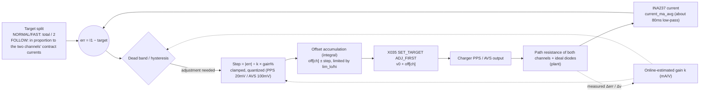
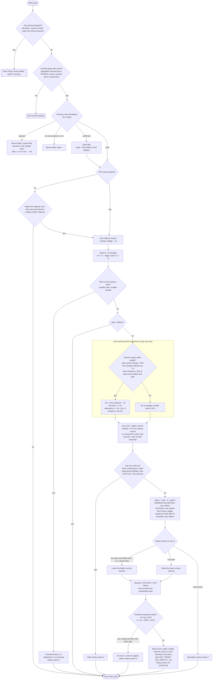

# Current-sharing control strategy (v0.0.71)

Corresponding code: `process_run()` in `src/power/share.c`; parameters are in `src/config.h`.

This is not a conventional PID but an **integral-type step controller with adaptive gain**:
- The output is an "offset voltage"; each step adds an increment to the existing offset, equivalent to the I term. There are no P or D terms.
- Step size = error ÷ online-estimated gain k × gain percentage (equivalent to a variable Ki).
- In addition, a dead band, predictive hysteresis and transient freeze are added to deal with the quantized steps of PPS/AVS and the slow response of the chargers.

## 1. Control structure

## 2. Each decision cycle (RUN)

## 3. Main parameters

| Parameter | Value | Purpose |
|---|---|---|
| `SHARE_PERIOD_MS` / `SHARE_FAST_PERIOD_MS` | 500 / 100 ms | Decision period |
| `SHARE_SETTLE_MS` / `SHARE_SETTLE_AVS_MS` | 300 / 1500 ms | Wait for current to settle after a new contract is confirmed |
| `SHARE_DIFF_PCT` / `FAST` / `FOLLOW` | 10 / 5 / 4 % | Dead band (2\|err\| relative to total current) |
| `SHARE_GAIN_PCT` / `SHARE_FAST_GAIN_PCT` | 50 / 80 % | Fraction of the required voltage taken as the step |
| `SHARE_STEP_MAX_MV` / `FAST` / `URGENT` | 100 / 200 / 300 mV | Maximum single step |
| `SHARE_STEP_MV` / `SHARE_AVS_STEP_MV` | 20 / 100 mV | Quantization step (PPS / AVS) |
| `SHARE_K_INIT/MIN/MAX_MA_PER_V` | 5 / 1 / 40 A/V | Gain initial value and range |
| `SHARE_K_EST_MIN_PCT` | 15 % | Minimum share of each channel when learning k (excludes the diode cutoff region) |
| `SHARE_PREDICT_PCT` | 160 % | Predictive hysteresis: no move if k × Δv exceeds this percentage of \|err\| |
| `SHARE_TRANSIENT_PCT` | 30 % | Transient freeze threshold |
| `SHARE_LIMIT_PCT` | 97 % | Near the contract limit, dead band and hysteresis do not apply |
| `SHARE_RANGE_MV` / `SHARE_FOLLOW_DOWN_MV` | 1000 / 1500 mV | Offset range (also limited by the protection window and the level range) |
| `SHARE_ACK_TIMEOUT_MS` / `SHARE_MAX_FAILS` | 1500 ms / 3 | Reply timeout and maximum consecutive failures |

## 4. Known limitations

- EPR AVS only has 100mV steps. When the path resistance is very small (measured k ≈ 14-16 A/V), a single step shifts about 1.6A, so at a 4A load the two channels can only reach a split error of about ±40% at best. The firmware stops at whichever of the two nearest states is predicted to be better and does not oscillate back and forth.
- Ways to improve: add about 25mΩ of current-sharing resistance in series with each channel to lower k; or use a voltage that has PPS (20mV steps).
