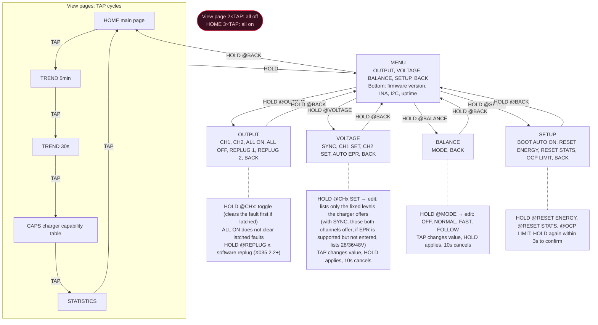

# Operating logic (v0.0.63)

A single touch key (TTP223). Events: single tap TAP, double tap 2×TAP, triple tap 3×TAP, long press HOLD (800ms).

- **View pages** (HOME, TREND 5min, TREND 30s, CAPS charger capability table, STATISTICS)
  - TAP cycles through pages, HOLD enters MENU.
  - 2×TAP turns all MOSFETs off.
  - 3×TAP on HOME turns all on (not turned on if both channels were already fully on before the double tap, to avoid a momentary dropout).
  - A single tap waits 300ms to confirm it is not a double tap before triggering.
- **Menu pages** (MENU, OUTPUT, VOLTAGE, BALANCE, SETUP)
  - TAP immediately moves to the next item, HOLD executes the item under the cursor.
  - BACK always returns to the previous level.
  - Double and triple taps are not recognized, so consecutive single taps cannot accidentally trigger all-off.

## Version history

- **v0.0.58** (suggestions 1, 2, 6, 7)
  - Multi-taps only work on view pages.
  - Single taps in menus trigger immediately.
  - OCP LIMIT requires a second confirmation.
  - Triple tap no longer causes a momentary dropout.
- **v0.0.59** (suggestions 3, 4, 5, 8)
  - TREND 5min and DIAG added to the view page cycle; HOLD always enters MENU.
  - New MENU main menu and a separate BALANCE page.
  - MOS page renamed OUTPUT, with ALL ON added.
  - Voltage options listed according to the capability table.
  - DIAG entry removed from STATISTICS.
  - ( ) + removed from the 16x24 font: "AUTO ON (BOOT)" changed to "BOOT AUTO ON", "SYNC CH1+CH2" changed to "SYNC BOTH CH".
- **v0.0.60**
  - DIAG page removed; the summary (firmware versions of the main controller and both X035s, INA status, I2C error count, uptime) is now shown on two lines at the bottom of MENU.
  - View page order changed to HOME → TREND 5min → TREND 30s → CAPS.
  - New CAPS page: capability tables listed with CH1 on the left and CH2 on the right; the current contract is marked in EVA green with ">", and EPR levels (position 8 and later) are in purple.
- **v0.0.61**: VOLTAGE page adds an AUTO EPR switch (on by default, saved in settings); the CAPS page title shows the EPR state (EPR-cap / EPR off / EPR:cable / EPR:rejected / EPR:failed). Requires X035Pd 2.1.0.
- **v0.0.62**: CAPS page changed to a table: type ⟷ voltage (right-aligned) ⟷ current / EPR AVS power (right-aligned), without PDO numbers; the current contract row has a dark purple background + EVA green text; the right side of the title shows the maximum power (or the reason EPR was not entered); the 0V padding entries in the SPR part of the EPR capability table are hidden (fix). Preview: docs/ui_caps.png (tools/caps_preview.py).
- **v0.0.63**: STATISTICS becomes a view page, placed after CAPS (HOME → TREND 5min → TREND 30s → CAPS → STATISTICS → HOME); clearing the current statistics moved to RESET STATS in SETUP (with second confirmation). CAPS rows are ordered by PDO position and show the position number: missing SPR positions are left blank, and EPR always starts at row 8.
- **v0.0.76**: OUTPUT page adds REPLUG 1 / REPLUG 2 (two items on the same line). A long press asks that channel's X035 to perform Type-C ErrorRecovery (removes the CC termination for 500ms; the charger sees an unplug and then reconnects), equivalent to unplugging and replugging the cable. Before executing, the channel is turned off with an uncounted "REPLUG" and its latch is cleared; a channel that was on is automatically restored once the new contract comes back, while one that was off or latched stays off. Rejected when the other channel's input is below 4.5V (3V3 comes only from the two VINs, so executing would power down the whole board). Requires X035Pd 2.2.0. The bottom hint line is changed to a protection status line.
- **v0.0.77**: REPLUG adds a second confirmation: the first long press only shows "HOLD again to replug CHx" and turns the item red; it executes only if the same item is long-pressed again within 3 seconds; moving the cursor or timing out cancels it.
